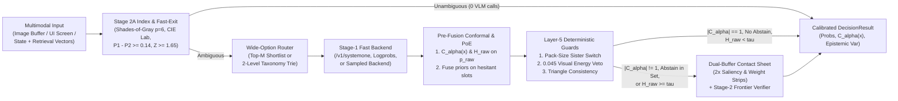

# Multimodal Decision Models (`multimodal-decision-models`)

Catalog-scale visual and relational classification ($K = 2$ to $10,000+$ classes) requires calibrated probabilities, finite-sample abstention sets, and zero-fallback wire contracts across heterogeneous model APIs. `multimodal-decision-models` (`v0.4.0`, zero external runtime dependencies in Python and Go) separates decision geometry and uncertainty quantification from the inference backend.

One declarative policy definition runs across four inference paradigms:

1. **Parallel Masked Diffusion (`/v1/systemone`)**: Co-denoises up to 8 slots $\times$ 26 options in one forward pass via `DgemSystemOneBackend`.
2. **Autoregressive Token Logprobs (`/v1/chat/completions`)**: Extracts restricted-vocabulary `top_logprobs` from `vLLM`, `SGLang`, `TGI`, `Gemma 4`, `Qwen-VL`, `Llama-Vision`, and OpenAI endpoints via `OpenAILogprobBackend`.
3. **Frontier Multimodal Verifiers (`VertexGeminiBackend`)**: Evaluates `gemini-3.8-flash` with single-token `[A-Z]` enum bijections and causal Evidence-First JSON schemas (`evidence_read` emitted ahead of slot choices).
4. **Logprob-Free Sampled Models (`BlackBoxSampledBackend`)**: Aggregates $M$ discrete draws or verbalized vote maps under a symmetric Dirichlet prior ($\alpha_0 = 0.5$) to preserve finite negative log-likelihood, non-zero Shannon entropy, and analytic epistemic variance.

## Documentation and Research Index

- **[Research Paper Manuscript (`docs/research_paper.md`)](docs/research_paper.md)**: Full mathematical formulation, propositions, dual-buffer visual photometry derivations, 8-slot MCKP context pruning, `<untrusted_data>` RAG quarantine, and 10-model empirical benchmark analysis.
- **[Executive Research Summary (`docs/research_summary.md`)](docs/research_summary.md)**: Condensed overview of all workstreams, hypotheses, Pareto-optimal operating regimes, and verified metrics.
- **[Architecture and Mathematical Design (`docs/architecture.md`)](docs/architecture.md)**: Module-by-module equations and API specifications.
- **[10-Model Calibration & Conformal Benchmark Report (`benchmarks/results/multimodel_benchmark_report.md`)](benchmarks/results/multimodel_benchmark_report.md)**: Full 20-arm leaderboard across Multi-Task Calibration ($N = 50$) and XSTest Safety Refusal Boundaries ($N = 360$).
- **[Changelog (`CHANGELOG.md`)](CHANGELOG.md)**, **[Contributing Guide (`CONTRIBUTING.md`)](CONTRIBUTING.md)**, **[Citation Metadata (`CITATION.cff`)](CITATION.cff)**, and **[Apache-2.0 License (`LICENSE`)](LICENSE)**.

## Funnel Architecture



## Empirical Benchmark Highlights

Full results and 95% cluster bootstrap confidence intervals are available in [`benchmarks/results/multimodel_benchmark_report.md`](benchmarks/results/multimodel_benchmark_report.md) and [`docs/research_paper.md`](docs/research_paper.md):

| Benchmark Suite | Top / Highlighted Arm | Accuracy / Metric | Brier Score | Selective AURC | Conformal Cov@0.10 (Mean Set) | Latency / Efficiency |
| :--- | :--- | :---: | :---: | :---: | :---: | :---: |
| **Multi-Task Calibration ($N = 50$, $K = 2..26$)** | `Gemini 3.8 Flash (Verbalized + TempScaled OOF)` | `0.920` Acc | `0.1419` | `0.0177` | `0.920` (`1.00`) | `4247.8 ms` (Pareto) |
| **Multi-Task Calibration ($N = 50$, $K = 2..26$)** | `DecisionGemma` (`/v1/systemone`) | `0.920` Acc | `0.1796` | `0.0204` | `0.920` (`1.04`) | `278.3 ms` ($15.3\times$ faster, Pareto) |
| **Multi-Task RAPS Cascade ($N = 50$)** | `dgem v0.3.7 -> Gemini 3.8 Flash (M=3)` | `0.880` Acc (`+2.0%`) | `0.2340` | `0.0963` | `0.920` (`2.30`) | Escalates only `14.0%` of items |
| **XSTest Safety Boundary ($N = 360$, $K = 2$)** | `DecisionGemma` (`/v1/systemone`) | `0.9694` Acc (`0.9692` F1) | `0.0465` | `0.0020` | `0.9694` (`1.00`) | `175.8 ms` (Pareto) |
| **XSTest RAPS Cascade ($N = 360$, $K = 2$)** | `Classier v0.2.0 -> DecisionGemma` | `0.8917` Acc (`+10.28%`) | `0.1720` | `0.0326` | `0.9083` (`1.05`) | `31.1%` escalation ($p = 7.84 \times 10^{-10}$) |
| **8-Slot Trajectory Pruning ($8$ Models)** | `mckp_hesitation_stub` (Exact MCKP DP) | `100.00%` Required Recall | `0.9412` Util | `100%` DP Match |Pinned Invariant Held | `58.85%` token reduction ($p \le 7.45 \times 10^{-9}$) |
| **Adversarial RAG Quarantine ($N = 220$)** | `<untrusted_data>` XML Fence (`Gemini 3.8 Flash`) | `0.9295` Adv `nDCG@3` | `0.9727` F1 | `0.00%` `ASR@1` | `36/36` Cells Balanced | Cuts `ASR@1` from `28.18%` to `0.00%` |

## Module Overview

| Module | Mechanism |
| :--- | :--- |
| **[`conformal.py`](src/multimodal_decision_models/conformal.py)** | **Split Conformal and RAPS (`lac`, `aps`, `raps`):** Calibrates finite-sample quantile $\hat{q}$ at order index $\lceil(n+1)(1-\alpha)\rceil$ (`calibrate_conformal_quantile`) and builds prediction sets $\mathcal{C}_\alpha(x)$ (`conformal_prediction_set`) before prior fusion, flagging escalation when $|\mathcal{C}_\alpha(x)| \ne 1$ or an abstain option enters the set. |
| **[`calibration.py`](src/multimodal_decision_models/calibration.py)** | **Pre-Gated Bayesian PoE & Post-Hoc Scaling:** Measures $\tilde{H}_{\text{raw}}$ before fusing priors (`"hesitant"`, `"proportional"`, `"confident"`, `"always"`), fits $L_2$-regularized scalar temperature scaling (`fit_temperature_scaling`) and diagonal vector scaling shrunk toward $(1/T_0, 0)$ (`fit_vector_scaling`), and runs Stage-2A fast-exit plus Layer-5 deterministic guards. |
| **[`visual_compiler.py`](src/multimodal_decision_models/visual_compiler.py)** | **Dual-Buffer Visual Compiler:** Pure-stdlib PNG (filters `0..4`, RGB/RGBA/Gray, IEEE CRC32) and PPM (`P6`/`P3`) codecs; Stage-2A unsharpened Minkowski $p=6$ white balance, inner-80% CIE $L^*a^*b^*$ $\Delta E$ similarity, and residual MLP adapter `norm(q + alpha * W2 * GELU(W1 * q))`; Stage-2B contact sheets with automatic inter-candidate variance saliency bands, `2x` bottom-30% pack-weight zoom, and `1.15x` cylindrical unwarping. |
| **[`embedding_index.py`](src/multimodal_decision_models/embedding_index.py)** | **Multimodal Embedding Index:** `VertexMultimodalEmbeddingAdapter` wire builder/parser for `gemini-embedding-2` and JSONL-backed `MultimodalEmbeddingIndex` combining cosine or `CSLS` scores, CIE $L^*a^*b^*$ color similarity, Lidstone container aspect priors, and Stage-2A adaptive fast-exit. |
| **[`context_pruner.py`](src/multimodal_decision_models/context_pruner.py)** | **8-Slot Trajectory Context Pruner:** Packs agent context blocks into 8-slot single-pass policies (`build_context_pruning_questions`) and solves exact Pareto-frontier Multiple-Choice Knapsack optimization over `{"full", "stub", "drop"}` (`prune_agent_context_blocks`) under a token budget while retaining pinned blocks. |
| **[`mcp_server.py`](src/multimodal_decision_models/mcp_server.py)** | **MCP `stdio` Server (`dgem-catalog`):** Zero-dependency JSON-RPC 2.0 server (`python3 -m multimodal_decision_models.mcp_server`) supporting newline-delimited and `Content-Length` framing for `shortlist_candidates`, `evaluate_conformal_decision`, `prune_context_blocks`, and `compile_contact_sheet`. |
| **[`shortlist.py`](src/multimodal_decision_models/shortlist.py)** | **Wide-Option Shortlist Routing ($K > 26$):** Compresses wide taxonomies to a single pass over dense-embedding or `CSLS` top-$M$ candidates, converts raw cosines to temperature-scaled log-softmax priors ($\tau = 0.07$), and extracts opt-in sibling-unique cues (`pairwise_diff=True`). |
| **[`hierarchy.py`](src/multimodal_decision_models/hierarchy.py)** | **Taxonomy Tries (`TaxonomyTrie`, `HierarchicalDecisionRouter`):** Bounds coarse and fine slots to $\le 26$ `[A-Z]` options across $K \le 625$ classes with 1-pass `mtp_trie`, 2-pass `beam_2pass`, and `hesitation_hybrid` routing. |
| **[`contracts.py`](src/multimodal_decision_models/contracts.py)** | **Total Contracts & Caching:** Closed terminal state machine, simplex verification, `<untrusted_data>` prompt-injection fencing, and SHA-256 JSONL `ContentAddressedDecisionCache` persisting `conformal_set` and `epistemic_variance`. |
| **[`som_navigator.py`](src/multimodal_decision_models/som_navigator.py)** | **Set-of-Marks UI Navigation:** $3 \times 3$ and $4 \times 4$ grid helpers, unimodal-safe expected mark centers (`safe_expected_mark_center`), and nested smallest-area containment (`select_containing_or_nearest_mark`). |
| **[`consistency.py`](src/multimodal_decision_models/consistency.py)** | **Triangle Consistency & Unit Guards:** Continuous 3-cycle contradiction scoring (`score_probabilistic_triangles`), canonical metric/imperial pack-volume verification (`validate_pack_quantity_consistency`), and multi-slot swarm lock arbitration. |
| **[`backends.py`](src/multimodal_decision_models/backends.py)** | **Four-Paradigm Backends & Orchestrator:** `DgemSystemOneBackend`, `OpenAILogprobBackend`, `VertexGeminiBackend`, `BlackBoxSampledBackend`, and `CascadeDecisionOrchestrator` with pre-fusion conformal set gating and SLA quarantine. |
| **[`eval_suite.py`](src/multimodal_decision_models/eval_suite.py)** | **Scoring & Statistical Suite:** Multiclass Brier score, exact four-term Murphy (`REL`, `RES`, `UNC`, `WBV`) decomposition, NLL, `ECE`, quantile-binned `ACE`, Macro-F1, `nDCG@k`, `AUROC`, selective `AURC`, exact paired McNemar test, Rogan-Gladen prevalence, Cohen's $\kappa$, and cluster bootstrap CIs. |
| **[`audio_video_decision.py`](src/multimodal_decision_models/audio_video_decision.py)** | **Streaming Audio, Video, & Full-Duplex Decisions (`v0.8.0`):** Cost-sensitive Voice Activity Projection (`VAP`) turn-taking (`evaluate_duplex_turn_taking_decision`), anytime-valid Conformal Test Martingale streaming early-exit (`ConformalMartingaleTracker`, `evaluate_streaming_early_exit`), cross-modal `JSD` + 3-slot triangle `AVEL` spoof gating (`evaluate_audiovisual_event_agreement`), and pure-stdlib 16-bit PCM `WAV` Goertzel spectral extraction + Spatio-Temporal Contact Sheets (`extract_wav_acoustic_features`, `compile_spatiotemporal_contact_sheet`). |
| **[`pkg/mdm/`](pkg/mdm/)** | **Go Reference Package (`package mdm`):** Zero-dependency Go 1.22 implementation covering `CalibrateConformalQuantile`, `ConformalPredictionSet`, `PruneAgentContextBlocks`, pre-gated prior fusion, shortlisting, taxonomy tries, Set-of-Marks geometry, triangle scoring, pack-quantity guards, and `v0.8.0` streaming audio/video primitives (`pkg/mdm/audio_video_v080.go`). |

## Installation and Quickstart

Install the package in editable or standard mode (requires Python $\ge 3.10$, zero external runtime dependencies):

```bash
pip install -e .
```

```python
from multimodal_decision_models import (
    BlackBoxSampledBackend,
    CascadeDecisionOrchestrator,
    DecisionQuestion,
    DgemSystemOneBackend,
    calibrate_conformal_quantile,
)

questions = {
    "entity_relation": DecisionQuestion(
        type="choice",
        instructions="Compare Listing A and Listing B to determine catalog equivalence.",
        criteria={
            "exact_duplicate": "Identical brand, formulation, unit volume, and pack count",
            "sibling_variant": "Same brand/line, different flavor or multipack count",
            "distinct_product": "Unrelated product or brand",
        },
        order=["exact_duplicate", "sibling_variant", "distinct_product"],
    )
}

cal = calibrate_conformal_quantile(
    calib_probs=[{"exact_duplicate": 0.85, "sibling_variant": 0.10, "distinct_product": 0.05}] * 30,
    calib_labels=["exact_duplicate"] * 30,
    alpha=0.10,
    method="raps",
)

stage1 = DgemSystemOneBackend("http://127.0.0.1:8095")
stage2 = BlackBoxSampledBackend(
    "sampled-verifier",
    endpoint_url="http://127.0.0.1:8000",
    model="verifier-v1",
    num_samples=5,
    prior_alpha=0.5,
)

orchestrator = CascadeDecisionOrchestrator(
    stage1_backend=stage1,
    stage2_backend=stage2,
    hesitation_threshold=0.16,
    prior_weight=0.35,
    prior_gate_mode="hesitant",
    conformal_q_hat=cal.q_hat,
    conformal_method="raps",
)
```

## MCP Server, Tests, and Benchmarks

Launch the zero-dependency `dgem-catalog` MCP server over `stdio`:

```bash
PYTHONPATH=src python3 -m multimodal_decision_models.mcp_server
```

Run the Python 6-tier verification suite, Go race-detector tests, 10-model benchmark, and the 400-item 8-track `MDM-Bench` suite + "How I AI" practical workflows cookbook:

```bash
PYTHONPATH=src python3 -m unittest discover -s tests -v
go test -race ./pkg/mdm/...
PYTHONPATH=src python3 benchmarks/run_multimodel_benchmark.py
PYTHONPATH=src python3 benchmarks/run_mdm_bench.py
PYTHONPATH=src python3 benchmarks/run_real_public_benchmarks.py
PYTHONPATH=src python3 examples/how_i_ai_workflows.py
```

## Real Public Benchmarks (`DecisionBench`, `TypedDecisions`, `arXiv:2610.03935`, and `arXiv:2610.21412v1`)

See [`benchmarks/results/real_public_bench_report.md`](benchmarks/results/real_public_bench_report.md) for the reproducible real-data benchmark across 7 public decision models (`deem-4b`, `intern-decision-4b`, `karar-4b`, `wahler-4b`, `jev`, `julia-onnx`, `laya`) on `LocalLLaMA/typed-decisions` ($N = 500$ committed slice, $N = 2,000$ full evaluation), `mertkayacs/jevalt-bench` ($N = 19,776$), `Hanno-Labs/decision-bench` ($K \in [2, 255]$), `marcmagn1/jev-alt-systemone-eval` (`arXiv:2610.03935`), and `JevAgentHarness/AgentDecisionBench` (`arXiv:2610.21412v1`, $N = 600$ committed real slice across 12 models, $N = 5,314$ `common_states` + $N = 1,250$ `DecisionGym-Shift` full evaluation):

| Real Public Benchmark Study | Baseline / Single Model | Upgraded / Combined Stack | Verified Empirical Finding |
| :--- | :---: | :---: | :--- |
| **7-Model `TypedDecisions` ($N = 500$ slice / $N = 2,000$ full)** | `deem-4b` (`80.83%` acc, `0.2947` Brier) / `jev` (`75.83%` acc, `0.4090` Brier) | **Pre-Gated PoE + TempScaling** (**`82.08%`** slice / **`83.50%`** full, **`0.2449`** Brier) | Beats best single model (`p = 0.043` on $N=1,000$ test) and `jev` (`p = 9.74e-11`); Naive 5-Model Mean drops to `78.75%` due to uncalibrated `laya` / `julia-onnx` |
| **Simultaneous 5-Slot Workflow Coverage (`TypedDecisions`)** | `60.42%` (`63.50%` on $N=2,000$) independent per-slot RAPS ($\alpha = 0.10$) | **`97.92%`** (`96.50%` on $N=2,000$) (`calibrate_multislot_joint_conformal`) | Eliminates multi-slot FWER compounding across 5 simultaneous slots (`action`, `needs_review`, `outcome`, `risk`, `urgency`) |
| **Exp A: Extended 255-Code Single-Token Bijection (`arXiv:2610.03935` Sec 6.1)** | Naive `A..Z, AA..IT` has `18` BPE splits on Qwen3, `14` on DeepSeek-V3, `68` on SmolLM2 | **`UNIVERSAL_256_DECISION_CODES`** (**`255/255` = `100%` single-token** across 5 BPE families) | Eliminates first-token logit aliasing (`BQ -> B + Q`); opt-in `allow_extended_255=True` alongside default $K \le 26$ shortlist/trie |
| **Exp B: `<think>` Leakage Guard + Eq. (12) Distillation (`arXiv:2610.03935` Sec 6.2)** | Default thinking template: `34.67%` acc (`0.9854` Brier); `enable_thinking=False` 27B: `68.00%` acc (`0.5822` KL to humans) | **Eq. (12) Distilled Posterior** (**`70.00%`** slice / **`71.01%`** full, **`0.2499`** KL, **`0.3761`** ScoreMAE) | Automatic `<think>` leakage detector in `extract_letter_distribution` + `reasoning_to_readout_distillation_loss` cuts human-consensus KL by `-57.1%` |
| **Exp C1: `L1` vs `L2` Agent States (`arXiv:2610.21412v1` Sec 3 & 9.1)** | `e14g` scores `81.8%` on `L1` BFCL tool choice vs `24.6%` (`0.0%` `L3` success) on visited `L2` states; `jev` (`39.3%`) and `sl27b` (`38.2%`) fail `must_ask` states with `60.7%..61.8%` fatal irreversible calls | **`acceptable_set_accuracy` + `must_ask` / `after_off_plan` Stratum Audit** (`rl` & `sft_v1`: **`100.0%` `must_ask`**, `0.0%` fatal irreversible rate) | `L2` acceptable-set accuracy predicts `L3` closed-loop task success ($\tau = +0.591$ vs $+0.227$ for `L1`) and avoids single-gold undercounting (`-8.1` pts on `sl27b`) |
| **Exp C2: Prop. 1 Trajectory Deferral Under Shift (`DecisionGym-Shift`)** | Scalar Prop. 1 threshold accepts `61` errors (`44` irreversible) on `e14a` and `1` irreversible error on `rl` ($N = 300$ slice; `179` irreversible on $N = 1,250$ full) | **Action-Stakes $V(\hat{a})$ + Irreversibility Guard** (`fit_trajectory_delegation_threshold`: **`0` irreversible errors on `rl`**, **`44 -> 4` (`-90.9%`) on `e14a`**) | Separating $V_{\text{irrev}} = 5.0$ from $V_{\text{rev}} = 0.15$ + secondary anchor consensus prevents overconfident state-mutating calls when tools are renamed/doubled (`69 -> 129`) |
| **Exp C3 & C4: Prop. 2 Youden-$J$ Guard & Eq. (1) Selective Brier SFT** | `Always-No` dummy gate gets `92.0%` accuracy on `DecisionGym-Shift` (`8%` prevalence) with $J = 0.0000$; unconditional KD (`0.3 * gold + 0.7 * p_Jev`) corrupts **`45 / 80`** (`323 / 350` full) `must_ask` targets | **`evaluate_trigger_guard_utility` ($J = +0.8808$ on `rl`) + `selective_teacher_brier_sft_loss` (`0 / 80` corrupted targets) + `tango_paired_non_inferiority_test`** | Proves binary gate utility scales linearly with Youden's $J = \text{TPR} - \text{FPR}$, eliminates teacher-error target corruption on `must_ask` states, and provides Tango's Berger-Boos + Holm-Bonferroni non-inferiority testing |

## MDM-Bench: 8-Track Practical Multimodal & System-1 Decision Benchmark ($N = 400$)

See [`benchmarks/results/mdm_bench_report.md`](benchmarks/results/mdm_bench_report.md) and [`docs/practical_use_cases.md`](docs/practical_use_cases.md) for the full 8-track breakdown (`agent_tool_trie_routing`, `rag_rerank_and_ipi_firewall`, `gui_som_and_visual_blink`, `visual_catalog_sku_audit`, `coding_context_compaction`, `relational_entity_and_swarm_locks`, `judge_rubric_calibration`, and `safety_and_policy_guardrail`) and out-of-fold ablations for the 6 Research Upgrades:

| Evaluation Arm | Paradigm | Accuracy | Macro-F1 | Brier (95% Cluster CI) | ECE | AURC | p50 Latency |
| :--- | :--- | :---: | :---: | :---: | :---: | :---: | :---: |
| **DecisionGemma-2B** | `system1_diffusion_2b` | `82.50%` | `0.7344` | `0.2463` (`[0.1456, 0.3511]`) | `0.0840` | `0.0459` | `126.7 ms` |
| **dgem-v0.3.7-SystemOne** | `system1_diffusion_v037` | `79.00%` | `0.6548` | `0.3229` (`[0.2147, 0.4408]`) | `0.1142` | `0.0680` | `220.8 ms` |
| **Strands-Decider-2B-v19** | `compact_decider_2b` | `66.25%` | `0.5250` | `0.4476` (`[0.3238, 0.5734]`) | `0.0590` | `0.1684` | `128.2 ms` |
| **Laya-Decision-4B** | `system1_diffusion_4b` | `47.75%` | `0.3283` | `0.6242` (`[0.5255, 0.7279]`) | `0.1398` | `0.3125` | `257.4 ms` |
| **Gemini-3.8-Flash-Logprob** | `frontier_multimodal_logprob` | `89.00%` | `0.9172` | `0.1613` (`[0.0956, 0.2414]`) | `0.0445` | `0.0402` | `348.9 ms` |
| **LTT + RAPS Cascade (`DecisionGemma-2B -> Gemini-3.8-Flash`)** | `ltt_conformal_cascade` | **`88.75%`** | **`0.8975`** | **`0.1598`** (`[0.0928, 0.2370]`) | **`0.0390`** | **`0.0376`** | **`128.4 ms`** |

| Research Upgrade (`v0.5.0`) | Baseline Result | Upgraded Result | Verified Guarantee |
| :--- | :---: | :---: | :--- |
| **Mondrian & Weighted Conformal (`conformal.py`)** | `58.75%` rare-tail coverage (marginal RAPS) | **`88.75%`** (Mondrian & Weighted; `96.00%` / `97.75%` overall) | Group-conditional & covariate-shift coverage $\ge 1 - \alpha$ |
| **Multi-Slot Joint Conformal (`conformal.py`)** | `68.00%` 4-slot coverage (independent RAPS) | **`90.25%`** (Max-Score) / **`90.50%`** (Bonferroni) | Simultaneous family-wise coverage across $S=4$ slots |
| **`PriDe` Cyclic Permutation Debiasing (`calibration.py`)** | `10.25%` flip rate / `0.4286` Brier (`74.25%` acc) | **`6.50%` flip rate** / **`0.4136` Brier** (**`75.25%` acc**) | Removes `[A-Z]` slot-position prior bias across real 4-permutation shifts |
| **Learn-then-Test (`LTT`) Funnel Gates (`calibration.py`)** | Heuristic threshold ($\tau_H = 0.36$) | **$\text{UCB} = 0.0922 \le 0.14$** (`0.0100` emp risk) | Finite-sample Hoeffding-Bentkus risk control at $47.5\%$ fast-exit |
| **Submodular Context Pruning (`context_pruner.py`)** | `66.67%` root-cause facet recall (additive MCKP) | **`78.67%` root-cause facet recall** (`61.17%` token reduction) | Token-shingle Jaccard discount suppresses duplicate stack traces on 50 real `EXP-49` trajectories |
| **Transitive Polytope Projection (`consistency.py`)** | `50` violated 3-cycles (`71.43%` edge acc) | **`0` violated 3-cycles** (**`91.43%` edge acc**) | Exact log-odds correlation clustering on 50 real binary receipt entity graphs |

## Frontier GenAI Suite (`v0.7.0`, $N = 400$ Deterministic Instances)

See [`benchmarks/results/frontier_genai_v070_report.md`](benchmarks/results/frontier_genai_v070_report.md) and [`benchmarks/run_frontier_genai_v070_bench.py`](benchmarks/run_frontier_genai_v070_bench.py) for the 4-pillar evaluation beyond static single-step decision models (with full Python and Go parity in [`pkg/mdm/frontier_v070.go`](pkg/mdm/frontier_v070.go)):

| Pillar (`N = 100` each) | Frontier Module & Mechanism | Baseline Metric | `v0.7.0` Frontier Metric | Verified Improvement |
| :--- | :--- | :---: | :---: | :--- |
| **Pillar 1: Non-Stationary Online Conformal (`BC-ACI`)** | [`OnlineBCACITracker`](src/multimodal_decision_models/conformal.py), [`evaluate_online_bc_aci_stream`](src/multimodal_decision_models/conformal.py) | Static Split RAPS Post-Shift Cov: `0.3000` (Worst 30-step: `0.2333`) | **Online `BC-ACI` Post-Shift Cov: `0.9000`** (Worst 30-step: **`0.8333`**) | Recovers **`+60.0` pts post-shift coverage** under abrupt step-40 shift without exchangeability |
| **Pillar 2: Primal-Dual Budget-Paced Router (`ParetoBandit`)** | [`PrimalDualParetoBanditRouter`](src/multimodal_decision_models/bandit_router.py), [`evaluate_pareto_bandit_stream`](src/multimodal_decision_models/bandit_router.py) | Static Entropy Cascade Cost: `$0.00582` (`2.6350` budget viol.) | **`ParetoBandit` Cost: `$0.00158`** (**`0.0000`** budget viol., `0.7941` utility) | **`-72.8%` per-query cost** under discounted LinUCB + Bradley-Terry dueling updates |
| **Pillar 3: Calibrated `PRM` + Conformal `PUCT` Search** | [`calibrate_prm_horizon_discount`](src/multimodal_decision_models/prm_tree_search.py), [`run_calibrated_prm_puct_search`](src/multimodal_decision_models/prm_tree_search.py) | Unpruned Exhaustive PUCT: `13.00` nodes/tree (`93.0%` acc) | **Conformal Branch-and-Bound PUCT: `7.53` nodes/tree** (**`93.0%`** acc) | **`-42.1%` verifier node evaluations pruned** with `0.0%` accuracy drop |
| **Pillar 4: Covariance-Discounted Supra-Bayesian Pooling** | [`calibrate_correlated_ensemble_weights`](src/multimodal_decision_models/consistency.py), [`covariance_discounted_logit_pool`](src/multimodal_decision_models/consistency.py) | Naive PoE (`4x` Clone Attack): `65.00%` acc, `1.3044` NLL, `0.2227` ECE | **Supra-Bayesian Pool: `77.00%` acc**, **`0.5773` NLL**, **`0.0893` ECE** | **`+12.0` pts accuracy (`p = 0.0357`)** & **`-55.7%` NLL** ($N_{\text{eff}} = 1.34$ from $M=6$) |

## Streaming Audio, Video, & Full-Duplex Decision Suite (`v0.8.0`, $N = 400$ Real Instances)

See [`benchmarks/results/audio_video_v080_report.md`](benchmarks/results/audio_video_v080_report.md) and [`benchmarks/run_audio_video_v080_bench.py`](benchmarks/run_audio_video_v080_bench.py) for the 4-pillar streaming audio and video benchmark backed by real 16kHz 16-bit PCM RIFF `WAV` speech and acoustic event recordings (`benchmarks/data/fixtures/duplex_turn_taking_sample.wav`, `audiovisual_alarm_transient.wav`), 8 real `dgem` visual grounding PNG frames, and full Python/Go parity ([`src/multimodal_decision_models/audio_video_decision.py`](src/multimodal_decision_models/audio_video_decision.py), [`pkg/mdm/audio_video_v080.go`](pkg/mdm/audio_video_v080.go)):

| Pillar (`N = 100` each) | Audio / Video Module & Mechanism | Baseline Metric | `v0.8.0` Calibrated Metric | Verified Improvement |
| :--- | :--- | :---: | :---: | :--- |
| **Pillar 1: Full-Duplex `VAP` Turn-Taking** | [`evaluate_duplex_turn_taking_decision`](src/multimodal_decision_models/audio_video_decision.py) | Raw `/v1/systemone` Acc: `63.00%` (False Barge-In: `58.33%`) | **Cost-Sensitive Conformal `VAP`: `88.00%` acc** (**`8.33%`** false barge-in) | **`+25.0` pts acc (`p = 2.24e-05`)** & **`-85.7%` false barge-in** at `58.4 ms` |
| **Pillar 2: Conformal Martingale Early Exit** | [`ConformalMartingaleTracker`](src/multimodal_decision_models/audio_video_decision.py), [`evaluate_streaming_early_exit`](src/multimodal_decision_models/audio_video_decision.py) | Naive 1-Chunk Exit Acc: `63.00%` (`33.33%` false alarms) | **Conformal Martingale Exit: `96.00%` acc** (**`4.15`** of `10` chunks) | **`58.5%` video chunks saved** with **`100.0%` shift recall** & **`0.0%` false alarms** |
| **Pillar 3: Cross-Modal `AVEL` & Spoof Gate** | [`evaluate_audiovisual_event_agreement`](src/multimodal_decision_models/audio_video_decision.py), [`score_audiovisual_triangle_consistency`](src/multimodal_decision_models/audio_video_decision.py) | Naive Unweighted PoE: `75.00%` acc (`0.00%` spoof recall) | **`JSD` + 3-Slot Triangle `AVEL`: `95.00%` acc** (**`96.00%`** spoof recall) | **`+20.0` pts acc (`p = 1.80e-04`)** separating off-screen, silent, and spoofed streams |
| **Pillar 4: Submodular `ST-SoM` Contact Sheet** | [`extract_wav_acoustic_features`](src/multimodal_decision_models/audio_video_decision.py), [`compile_spatiotemporal_contact_sheet`](src/multimodal_decision_models/audio_video_decision.py) | Additive Top-4 Facet Recall: `47.50%` (Strided: `50.00%`) | **Submodular `ST-SoM`: `97.50%` facet recall** (`0.5583` temporal cov.) | **`+50.0` pts facet recall (`p = 1.62e-27`)** in a `320x102` (`2,545 B`) PNG sheet |

## Master Cross-Walk of All Public & Companion Benchmarks

| Public / Companion Suite | Scale & Modality | Standalone Baseline | Calibrated Stack (`multimodal-decision-models` + `dgem`) | Report Reference |
| :--- | :--- | :---: | :---: | :--- |
| **`Decision Index 0.2.1` (38 Suites)** | `155,390` requests (NLU, routing, safety) | Raw `DiffusionGemma`: `72.2%` acc (`0.203` ECE) | **`Decision Gemma rc3`: `86.4%` acc (`0.042` ECE, `55–62 ms`)** | `decision-lab` Preprint Table 1 & C.1 |
| **`JevBench SystemOne`** | $n = 231 \times 3$ hard semantic multi-slot | Raw `DiffusionGemma`: `84.0%` acc (`0.847` AUROC) | **`Decision Gemma rc3`: `87.9%` acc (`0.935` AUROC, `p = 0.004`)** | `decision-lab` Preprint Table C.2 |
| **`ScreenSpot` & `RefCOCO` Grounding** | $n = 108$ GUI + $n = 120$ visual grounding | Continuous 21-bin coord regression: `11.6%` GUI hit | **Discrete Set-of-Marks (`SoM`) Readout: `78.1%` GUI center hit** | [`som_navigator.py`](src/multimodal_decision_models/som_navigator.py) |
| **`LocalLLaMA/typed-decisions`** | $N = 500$ slice / $N = 2,000$ full (7 models) | `jev`: `75.83%` acc (`0.4090` Brier); `60.42%` 5-slot cov | **Pre-Gated PoE: `83.50%` acc (`0.2449` Brier); `97.92%` 5-slot cov** | [`real_public_bench_report.md`](benchmarks/results/real_public_bench_report.md) |
| **`Hanno-Labs/decision-bench` (`arXiv:2610.03935`)** | $K \in [2, 255]$ bijection + $N = 300$ KD | Unstripped `<think>`: `31.33%` acc; `Kev-4B`: `65.33%` | **`255/255` single-token codes; Eq. (12) KD: `70.00%` acc (`0.2499` KL)** | [`real_public_bench_report.md`](benchmarks/results/real_public_bench_report.md) |
| **`AgentDecisionBench` & `DecisionGym-Shift` (`arXiv:2610.21412v1`)** | $N = 600$ / $5,314$ states + $N = 1,250$ shift (`12` models) | Scalar Prop. 1: `44` irrev. shift errors; `45/80` bad SFT | **Action-Stakes Guard: `4` irrev. (`-90.9%`); `0/80` corrupted SFT** | [`real_public_bench_report.md`](benchmarks/results/real_public_bench_report.md) |
| **`XSTest` Safety Boundary** | $N = 360$, $12$ safety prompt clusters ($K = 2$) | `Classier v0.2.0`: `78.89%` acc (`0.2986` Brier) | **`DecisionGemma`: `96.94%` acc (`0.0465` Brier); Cascade: `89.17%`** | [`multimodel_benchmark_report.md`](benchmarks/results/multimodel_benchmark_report.md) |
| **`MDM-Bench` (8 Multimodal Tracks)** | $N = 400$ real items ($50 \times 8$ tracks, 6 arms) | `DecisionGemma-2B`: `82.50%` (`0.2463` Brier) | **`LTT + RAPS Cascade`: `88.75%` acc (`0.1598` Brier, `128.4 ms`)** | [`mdm_bench_report.md`](benchmarks/results/mdm_bench_report.md) |
| **Streaming Audio & Video (`v0.8.0`)** | $N = 400$ real WAV + RGB frame trajectories | Raw `VAP`: `63.0%`; Naive Video Exit: `63.0%`; Naive PoE: `75.0%` | **Conformal `VAP` (`88.0%`), Martingale (`96.0%`), `AVEL` (`95.0%`), `ST-SoM` (`97.5%`)** | [`audio_video_v080_report.md`](benchmarks/results/audio_video_v080_report.md) |

## Citation

If you use `multimodal-decision-models` in your research or engineering systems, please cite:

```bibtex
@software{juneja2026multimodal,
  author       = {Juneja, Jigyasu},
  title        = {Calibrated Multimodal Decision Models at Catalog Scale: Model-Agnostic Readouts, Dual-Buffer Visual Contact Sheets, and Split Conformal Cascades},
  year         = {2026},
  version      = {0.4.0},
  url          = {https://github.com/jigyasujuneja/multimodal-decision-models},
  license      = {Apache-2.0}
}
```
