# Multimodal Decision Models (`multimodal-decision-models`)

Backend-agnostic architecture, calibration primitives, and multi-slot policy templates for **Calibrated Multimodal Decision Models** at catalog scale ($K = 2$ to $10,000+$ classes).

`multimodal-decision-models` decouples **decision geometry and epistemic calibration** from the underlying inference engine. The same declarative policies, pre-gated prior fusion, wide-option shortlist routers, hierarchical semantic taxonomy tries, Set-of-Marks UI pathfinders, and transitive triangle-consistency verifiers execute across:

1. **Parallel Masked Diffusion Decision Models (`/v1/systemone`)**: Co-denoising up to 8 slots $\times$ 26 options in one forward pass via `DgemSystemOneBackend`.
2. **Autoregressive Single-Token Logprob Engines (`/v1/chat/completions`)**: `vLLM`, `SGLang`, `TGI`, `Gemma 4`, `Qwen-VL`, `Llama-Vision`, and OpenAI endpoints via restricted-vocabulary `top_logprobs` extraction (`OpenAILogprobBackend`).
3. **Frontier Multimodal Verifiers (`VertexGeminiBackend`)**: `gemini-3.8-flash` using Causal Attention **Evidence-First** JSON schemas (`evidence_read` emitted before slot choices so lower-triangular attention conditions directly on the decoded visual evidence in the KV cache).

## 1. End-to-End Decision Funnel Architecture

```mermaid
flowchart LR
    Q["Multimodal Input\n(Image Crops / UI Screen /\nTranscript + Prior Logits)"] --> S2A["Stage 2A Fast-Exit Gate\n(P1 - P2 >= 0.14, Z >= 1.65,\nNo Sister Pack Collision)"]
    S2A -- "Pass (0 VLM calls)" --> OUT["Calibrated DecisionResult\n(Probs, H_raw, Confidence C2)"]
    S2A -- "Ambiguous" --> SL["Wide-Option Router\n(Top-M Shortlist or\n2-Level Taxonomy Trie)"]
    SL --> EV["Evidence Slot Injection\n(Co-Denoised Canvas or\nCausal Evidence-First)"]
    EV --> B1["Stage-1 Fast Backend\n(/v1/systemone or\nLocal vLLM Logprobs)"]
    B1 --> POE["Pre-Gated Bayesian PoE\n1. Measure H_raw on p_raw\n2. Fuse on hesitant items"]
    POE --> L5["Layer-5 Deterministic Guards\n1. Pack-Size Sister Switch\n2. 0.045 Visual Energy Veto\n3. Triangle Consistency"]
    L5 -- "H_raw < 0.16 &\nGrounded Evidence" --> OUT
    L5 -- "H_raw >= 0.16 or\nInferred / Conflict" --> B2["Stage-2 Frontier Verifier\n(Gemini 3.8 Flash)"]
    B2 --> OUT
```



## 2. Core Modules & Mathematical Formulations

See [`docs/architecture.md`](docs/architecture.md) for derivations and design guidance.

| Module | Core Mechanism |
| :--- | :--- |
| **[`calibration.py`](src/multimodal_decision_models/calibration.py)** | **Pre-Gated Bayesian PoE Fusion:** Evaluates cardinality-normalized Shannon entropy $\tilde{H}_{\text{raw}} = -\sum_{k=1}^K p_{\text{raw},k}\ln p_{\text{raw},k} / \ln K$ strictly before fusing retrieval or base-rate priors $p_k \propto \exp(\ln p_{\text{raw},k}/T + w_{\text{eff}}\cdot \pi_k)$, defaulting to `gate_mode="hesitant"` (`"always"`, `"confident"`, `"hesitant"`, `"proportional"`).<br>**Stage 2A Fast-Exit Gate:** Resolves high-margin dense-embedding hits ($P_1 - P_2 \ge 0.14, Z \ge 1.65$) in `0` VLM calls.<br>**Layer-5 Post-Generation Guards:** Deterministic Pack-Size Sister Switch, `0.045` Visual Energy Veto, and `none_of_the_above` Competitor Similarity Guard ($\ge 0.72$). |
| **[`shortlist.py`](src/multimodal_decision_models/shortlist.py)** | **Wide-Option Shortlist Routing ($K > 26$):** Reduces wide choices from packed bracket tournaments ($1 + \lceil\lceil K/20 \rceil / 8\rceil$ passes) to a single pass over dense-embedding or `CSLS(q, p_k) = 2\cos(q, p_k) - r_T(p_k)` top-$M$ candidates (default $M = 20$), preserving `none_of_the_above` catch-alls, converting raw cosines into temperature-scaled log-softmax priors (`normalize_cosine_prior_logits`, $\tau = 0.07$), and supporting opt-in sibling-unique cues (`pairwise_diff=True`, `build_contrastive_criteria`) for boilerplate-heavy catalogs. |
| **[`hierarchy.py`](src/multimodal_decision_models/hierarchy.py)** | **Hierarchical Semantic Taxonomy Readout (`TaxonomyTrie`, `HierarchicalDecisionRouter`):** Keeps each slot within $\le 26$ single-token `[A-Z]` options across $K \le 625$ classes with opaque `option_N` lexical stem bucketing, cross-domain `role_<suffix>` alignment, 1-pass trie-constrained joint log-probability decoding $s(e \mid x) = \log P_1(c_1(e) \mid x) + \log P_2(c_2(e) \mid x)$ (`mtp_trie`), 2-pass top-$b$ domain beam routing (`beam_2pass`), hesitation-gated hybrid routing (`hesitation_hybrid`), and `packed_bracket_pass_count`. |
| **[`som_navigator.py`](src/multimodal_decision_models/som_navigator.py)** | **Set-of-Marks (`SoM`) Discrete UI Pathfinder:** Replaces continuous coordinate regression with $3 \times 3$ and $4 \times 4$ spatial grid helpers (`assign_box_to_grid_cell`, `assign_box_to_grid_4x4`, `grid_4x4_cell_bounds`), probability-weighted expected mark centers (`expected_mark_center_from_probabilities`), nested smallest-area containment (`select_containing_or_nearest_mark`), and 4-slot single-pass policy construction. |
| **[`consistency.py`](src/multimodal_decision_models/consistency.py)** | **Continuous & Thresholded Triangle-Consistency Scorers:** Ranks 3-cycles $(A, B, C)$ by soft transitive contradiction $\max p_{ij}p_{jk}(1 - p_{ik}) \in [0, 1]$ (`score_probabilistic_triangles`) alongside hard threshold audits (`check_transitive_triangles`).<br>**Pack-Quantity Equivalence Verifier & Multi-Slot Swarm Lock Arbiter.** |
| **[`backends.py`](src/multimodal_decision_models/backends.py)** | Unified `DecisionBackend` protocol implemented by `DgemSystemOneBackend` (live `/v1/systemone` schema), `OpenAILogprobBackend` (`/v1/chat/completions`), `VertexGeminiBackend` (Vertex AI `generateContent` with `responseLogprobs`), and `CascadeDecisionOrchestrator` (supporting `escalate_on_inferred_evidence`). |
| **[`pkg/mdm/`](pkg/mdm/)** | Standalone Go reference implementation (`package mdm`) for pre-gated prior fusion (`"always"`, `"confident"`, `"hesitant"`, `"proportional"`, `"off"`), `NormalizeCosinePriorLogits`, `PackedBracketPassCount`, wide-option shortlisting, `BuildContrastiveCriteria`, `DecodeTaxonomyTrie`, $4 \times 4$ Set-of-Marks geometry (`ExpectedMarkCenterFromProbabilities`), and continuous `ScoreProbabilisticTriangles`. |

## 3. Quickstart Across Backends

```python
from multimodal_decision_models import (
    CascadeDecisionOrchestrator,
    DecisionQuestion,
    DgemSystemOneBackend,
    OpenAILogprobBackend,
    VertexGeminiBackend,
)

questions = {
    "entity_relation": DecisionQuestion(
        type="choice",
        instructions="Compare Listing A and Listing B to determine catalog equivalence.",
        criteria={
            "exact_duplicate": "Identical brand, formulation, unit volume, and pack count",
            "sibling_variant": "Same brand/line, different flavor or multipack count",
            "distinct_product": "Unrelated product or brand",
        },
        order=["exact_duplicate", "sibling_variant", "distinct_product"],
    )
}

stage1 = DgemSystemOneBackend("http://127.0.0.1:8095")
# Or: stage1 = OpenAILogprobBackend("http://127.0.0.1:8000", model="google/gemma-4-9b-it")
stage2 = VertexGeminiBackend(project="my-gcp-project", model="gemini-3.8-flash")

orchestrator = CascadeDecisionOrchestrator(
    stage1_backend=stage1,
    stage2_backend=stage2,
    hesitation_threshold=0.16,
    prior_weight=0.35,
    prior_gate_mode="hesitant",
    shortlist_top_k=20,
    evidence_prompt="Identify the decisive visual or pack-quantity cue before choosing.",
    enable_stage2a_fast_exit=True,
    escalate_on_inferred_evidence=True,
)
```

## 4. Running Tests

```bash
PYTHONPATH=src python3 -m unittest discover -s tests -v
go test -race ./pkg/mdm/...
```
