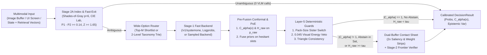

# Multimodal Decision Models (`multimodal-decision-models`)

Catalog-scale visual and relational classification ($K = 2$ to $10,000+$ classes) requires calibrated probabilities, finite-sample abstention sets, and zero-fallback wire contracts across heterogeneous model APIs. `multimodal-decision-models` (`v0.4.0`, zero external runtime dependencies in Python and Go) separates decision geometry and uncertainty quantification from the inference backend.

One declarative policy definition runs across four inference paradigms:

1. **Parallel Masked Diffusion (`/v1/systemone`)**: Co-denoises up to 8 slots $\times$ 26 options in one forward pass via `DgemSystemOneBackend`.
2. **Autoregressive Token Logprobs (`/v1/chat/completions`)**: Extracts restricted-vocabulary `top_logprobs` from `vLLM`, `SGLang`, `TGI`, `Gemma 4`, `Qwen-VL`, `Llama-Vision`, and OpenAI endpoints via `OpenAILogprobBackend`.
3. **Frontier Multimodal Verifiers (`VertexGeminiBackend`)**: Evaluates `gemini-3.8-flash` with single-token `[A-Z]` enum bijections and causal Evidence-First JSON schemas (`evidence_read` emitted ahead of slot choices).
4. **Logprob-Free Sampled Models (`BlackBoxSampledBackend`)**: Aggregates $M$ discrete draws or verbalized vote maps under a symmetric Dirichlet prior ($\alpha_0 = 0.5$) to preserve finite negative log-likelihood, non-zero Shannon entropy, and analytic epistemic variance.

## Documentation and Research Index

- **[Research Paper Manuscript (`docs/research_paper.md`)](docs/research_paper.md)**: Full mathematical formulation, propositions, dual-buffer visual photometry derivations, 8-slot MCKP context pruning, `<untrusted_data>` RAG quarantine, and 10-model empirical benchmark analysis.
- **[Executive Research Summary (`docs/research_summary.md`)](docs/research_summary.md)**: Condensed overview of all workstreams, hypotheses, Pareto-optimal operating regimes, and verified metrics.
- **[Architecture and Mathematical Design (`docs/architecture.md`)](docs/architecture.md)**: Module-by-module equations and API specifications.
- **[10-Model Calibration & Conformal Benchmark Report (`benchmarks/results/multimodel_benchmark_report.md`)](benchmarks/results/multimodel_benchmark_report.md)**: Full 20-arm leaderboard across Multi-Task Calibration ($N = 50$) and XSTest Safety Refusal Boundaries ($N = 360$).
- **[Changelog (`CHANGELOG.md`)](CHANGELOG.md)**, **[Contributing Guide (`CONTRIBUTING.md`)](CONTRIBUTING.md)**, **[Citation Metadata (`CITATION.cff`)](CITATION.cff)**, and **[Apache-2.0 License (`LICENSE`)](LICENSE)**.

## Funnel Architecture



## Empirical Benchmark Highlights

Full results and 95% cluster bootstrap confidence intervals are available in [`benchmarks/results/multimodel_benchmark_report.md`](benchmarks/results/multimodel_benchmark_report.md) and [`docs/research_paper.md`](docs/research_paper.md):

| Benchmark Suite | Top / Highlighted Arm | Accuracy / Metric | Brier Score | Selective AURC | Conformal Cov@0.10 (Mean Set) | Latency / Efficiency |
| :--- | :--- | :---: | :---: | :---: | :---: | :---: |
| **Multi-Task Calibration ($N = 50$, $K = 2..26$)** | `Gemini 3.8 Flash (Verbalized + TempScaled OOF)` | `0.920` Acc | `0.1419` | `0.0177` | `0.920` (`1.00`) | `4247.8 ms` (Pareto) |
| **Multi-Task Calibration ($N = 50$, $K = 2..26$)** | `DecisionGemma` (`/v1/systemone`) | `0.920` Acc | `0.1796` | `0.0204` | `0.920` (`1.04`) | `278.3 ms` ($15.3\times$ faster, Pareto) |
| **Multi-Task RAPS Cascade ($N = 50$)** | `dgem v0.3.7 -> Gemini 3.8 Flash (M=3)` | `0.880` Acc (`+2.0%`) | `0.2340` | `0.0963` | `0.920` (`2.30`) | Escalates only `14.0%` of items |
| **XSTest Safety Boundary ($N = 360$, $K = 2$)** | `DecisionGemma` (`/v1/systemone`) | `0.9694` Acc (`0.9692` F1) | `0.0465` | `0.0020` | `0.9694` (`1.00`) | `175.8 ms` (Pareto) |
| **XSTest RAPS Cascade ($N = 360$, $K = 2$)** | `Classier v0.2.0 -> DecisionGemma` | `0.8917` Acc (`+10.28%`) | `0.1720` | `0.0326` | `0.9083` (`1.05`) | `31.1%` escalation ($p = 7.84 \times 10^{-10}$) |
| **8-Slot Trajectory Pruning ($8$ Models)** | `mckp_hesitation_stub` (Exact MCKP DP) | `100.00%` Required Recall | `0.9412` Util | `100%` DP Match |Pinned Invariant Held | `58.85%` token reduction ($p \le 7.45 \times 10^{-9}$) |
| **Adversarial RAG Quarantine ($N = 220$)** | `<untrusted_data>` XML Fence (`Gemini 3.8 Flash`) | `0.9295` Adv `nDCG@3` | `0.9727` F1 | `0.00%` `ASR@1` | `36/36` Cells Balanced | Cuts `ASR@1` from `28.18%` to `0.00%` |

## Module Overview

| Module | Mechanism |
| :--- | :--- |
| **[`conformal.py`](src/multimodal_decision_models/conformal.py)** | **Split Conformal and RAPS (`lac`, `aps`, `raps`):** Calibrates finite-sample quantile $\hat{q}$ at order index $\lceil(n+1)(1-\alpha)\rceil$ (`calibrate_conformal_quantile`) and builds prediction sets $\mathcal{C}_\alpha(x)$ (`conformal_prediction_set`) before prior fusion, flagging escalation when $|\mathcal{C}_\alpha(x)| \ne 1$ or an abstain option enters the set. |
| **[`calibration.py`](src/multimodal_decision_models/calibration.py)** | **Pre-Gated Bayesian PoE & Post-Hoc Scaling:** Measures $\tilde{H}_{\text{raw}}$ before fusing priors (`"hesitant"`, `"proportional"`, `"confident"`, `"always"`), fits $L_2$-regularized scalar temperature scaling (`fit_temperature_scaling`) and diagonal vector scaling shrunk toward $(1/T_0, 0)$ (`fit_vector_scaling`), and runs Stage-2A fast-exit plus Layer-5 deterministic guards. |
| **[`visual_compiler.py`](src/multimodal_decision_models/visual_compiler.py)** | **Dual-Buffer Visual Compiler:** Pure-stdlib PNG (filters `0..4`, RGB/RGBA/Gray, IEEE CRC32) and PPM (`P6`/`P3`) codecs; Stage-2A unsharpened Minkowski $p=6$ white balance, inner-80% CIE $L^*a^*b^*$ $\Delta E$ similarity, and residual MLP adapter `norm(q + alpha * W2 * GELU(W1 * q))`; Stage-2B contact sheets with automatic inter-candidate variance saliency bands, `2x` bottom-30% pack-weight zoom, and `1.15x` cylindrical unwarping. |
| **[`embedding_index.py`](src/multimodal_decision_models/embedding_index.py)** | **Multimodal Embedding Index:** `VertexMultimodalEmbeddingAdapter` wire builder/parser for `gemini-embedding-2` and JSONL-backed `MultimodalEmbeddingIndex` combining cosine or `CSLS` scores, CIE $L^*a^*b^*$ color similarity, Lidstone container aspect priors, and Stage-2A adaptive fast-exit. |
| **[`context_pruner.py`](src/multimodal_decision_models/context_pruner.py)** | **8-Slot Trajectory Context Pruner:** Packs agent context blocks into 8-slot single-pass policies (`build_context_pruning_questions`) and solves exact Pareto-frontier Multiple-Choice Knapsack optimization over `{"full", "stub", "drop"}` (`prune_agent_context_blocks`) under a token budget while retaining pinned blocks. |
| **[`mcp_server.py`](src/multimodal_decision_models/mcp_server.py)** | **MCP `stdio` Server (`dgem-catalog`):** Zero-dependency JSON-RPC 2.0 server (`python3 -m multimodal_decision_models.mcp_server`) supporting newline-delimited and `Content-Length` framing for `shortlist_candidates`, `evaluate_conformal_decision`, `prune_context_blocks`, and `compile_contact_sheet`. |
| **[`shortlist.py`](src/multimodal_decision_models/shortlist.py)** | **Wide-Option Shortlist Routing ($K > 26$):** Compresses wide taxonomies to a single pass over dense-embedding or `CSLS` top-$M$ candidates, converts raw cosines to temperature-scaled log-softmax priors ($\tau = 0.07$), and extracts opt-in sibling-unique cues (`pairwise_diff=True`). |
| **[`hierarchy.py`](src/multimodal_decision_models/hierarchy.py)** | **Taxonomy Tries (`TaxonomyTrie`, `HierarchicalDecisionRouter`):** Bounds coarse and fine slots to $\le 26$ `[A-Z]` options across $K \le 625$ classes with 1-pass `mtp_trie`, 2-pass `beam_2pass`, and `hesitation_hybrid` routing. |
| **[`contracts.py`](src/multimodal_decision_models/contracts.py)** | **Total Contracts & Caching:** Closed terminal state machine, simplex verification, `<untrusted_data>` prompt-injection fencing, and SHA-256 JSONL `ContentAddressedDecisionCache` persisting `conformal_set` and `epistemic_variance`. |
| **[`som_navigator.py`](src/multimodal_decision_models/som_navigator.py)** | **Set-of-Marks UI Navigation:** $3 \times 3$ and $4 \times 4$ grid helpers, unimodal-safe expected mark centers (`safe_expected_mark_center`), and nested smallest-area containment (`select_containing_or_nearest_mark`). |
| **[`consistency.py`](src/multimodal_decision_models/consistency.py)** | **Triangle Consistency & Unit Guards:** Continuous 3-cycle contradiction scoring (`score_probabilistic_triangles`), canonical metric/imperial pack-volume verification (`validate_pack_quantity_consistency`), and multi-slot swarm lock arbitration. |
| **[`backends.py`](src/multimodal_decision_models/backends.py)** | **Four-Paradigm Backends & Orchestrator:** `DgemSystemOneBackend`, `OpenAILogprobBackend`, `VertexGeminiBackend`, `BlackBoxSampledBackend`, and `CascadeDecisionOrchestrator` with pre-fusion conformal set gating and SLA quarantine. |
| **[`eval_suite.py`](src/multimodal_decision_models/eval_suite.py)** | **Scoring & Statistical Suite:** Multiclass Brier score, exact four-term Murphy (`REL`, `RES`, `UNC`, `WBV`) decomposition, NLL, `ECE`, quantile-binned `ACE`, Macro-F1, `nDCG@k`, `AUROC`, selective `AURC`, exact paired McNemar test, Rogan-Gladen prevalence, Cohen's $\kappa$, and cluster bootstrap CIs. |
| **[`pkg/mdm/`](pkg/mdm/)** | **Go Reference Package (`package mdm`):** Zero-dependency Go 1.22 implementation covering `CalibrateConformalQuantile`, `ConformalPredictionSet`, `PruneAgentContextBlocks`, pre-gated prior fusion, shortlisting, taxonomy tries, Set-of-Marks geometry, triangle scoring, and pack-quantity guards. |

## Installation and Quickstart

Install the package in editable or standard mode (requires Python $\ge 3.10$, zero external runtime dependencies):

```bash
pip install -e .
```

```python
from multimodal_decision_models import (
    BlackBoxSampledBackend,
    CascadeDecisionOrchestrator,
    DecisionQuestion,
    DgemSystemOneBackend,
    calibrate_conformal_quantile,
)

questions = {
    "entity_relation": DecisionQuestion(
        type="choice",
        instructions="Compare Listing A and Listing B to determine catalog equivalence.",
        criteria={
            "exact_duplicate": "Identical brand, formulation, unit volume, and pack count",
            "sibling_variant": "Same brand/line, different flavor or multipack count",
            "distinct_product": "Unrelated product or brand",
        },
        order=["exact_duplicate", "sibling_variant", "distinct_product"],
    )
}

cal = calibrate_conformal_quantile(
    calib_probs=[{"exact_duplicate": 0.85, "sibling_variant": 0.10, "distinct_product": 0.05}] * 30,
    calib_labels=["exact_duplicate"] * 30,
    alpha=0.10,
    method="raps",
)

stage1 = DgemSystemOneBackend("http://127.0.0.1:8095")
stage2 = BlackBoxSampledBackend(
    "sampled-verifier",
    endpoint_url="http://127.0.0.1:8000",
    model="verifier-v1",
    num_samples=5,
    prior_alpha=0.5,
)

orchestrator = CascadeDecisionOrchestrator(
    stage1_backend=stage1,
    stage2_backend=stage2,
    hesitation_threshold=0.16,
    prior_weight=0.35,
    prior_gate_mode="hesitant",
    conformal_q_hat=cal.q_hat,
    conformal_method="raps",
)
```

## MCP Server, Tests, and Benchmarks

Launch the zero-dependency `dgem-catalog` MCP server over `stdio`:

```bash
PYTHONPATH=src python3 -m multimodal_decision_models.mcp_server
```

Run the Python 6-tier verification suite, Go race-detector tests, 10-model benchmark, and the 400-item 8-track `MDM-Bench` suite + "How I AI" practical workflows cookbook:

```bash
PYTHONPATH=src python3 -m unittest discover -s tests -v
go test -race ./pkg/mdm/...
PYTHONPATH=src python3 benchmarks/run_multimodel_benchmark.py
PYTHONPATH=src python3 benchmarks/run_mdm_bench.py
PYTHONPATH=src python3 benchmarks/run_real_public_benchmarks.py
PYTHONPATH=src python3 examples/how_i_ai_workflows.py
```

## Real Public Benchmarks (`DecisionBench`, `TypedDecisions`, and `arXiv:2610.03935` Distillation)

See [`benchmarks/results/real_public_bench_report.md`](benchmarks/results/real_public_bench_report.md) for the reproducible real-data benchmark across 7 public decision models (`deem-4b`, `intern-decision-4b`, `karar-4b`, `wahler-4b`, `jev`, `julia-onnx`, `laya`) on `LocalLLaMA/typed-decisions` ($N = 500$ committed slice, $N = 2,000$ full evaluation), `mertkayacs/jevalt-bench` ($N = 19,776$), `Hanno-Labs/decision-bench` ($K \in [2, 255]$), and `marcmagn1/jev-alt-systemone-eval` (`arXiv:2610.03935` reasoning-to-readout distillation):

| Real Public Benchmark Study | Baseline / Single Model | Upgraded / Combined Stack | Verified Empirical Finding |
| :--- | :---: | :---: | :--- |
| **7-Model `TypedDecisions` ($N = 500$ slice / $N = 2,000$ full)** | `deem-4b` (`80.83%` acc, `0.2947` Brier) / `jev` (`75.83%` acc, `0.4090` Brier) | **Pre-Gated PoE + TempScaling** (**`82.08%`** slice / **`83.50%`** full, **`0.2449`** Brier) | Beats best single model (`p = 0.043` on $N=1,000$ test) and `jev` (`p = 9.74e-11`); Naive 5-Model Mean drops to `78.75%` due to uncalibrated `laya` / `julia-onnx` |
| **Simultaneous 5-Slot Workflow Coverage (`TypedDecisions`)** | `60.42%` (`63.50%` on $N=2,000$) independent per-slot RAPS ($\alpha = 0.10$) | **`97.92%`** (`96.50%` on $N=2,000$) (`calibrate_multislot_joint_conformal`) | Eliminates multi-slot FWER compounding across 5 simultaneous slots (`action`, `needs_review`, `outcome`, `risk`, `urgency`) |
| **Exp A: Extended 255-Code Single-Token Bijection (`arXiv:2610.03935` Sec 6.1)** | Naive `A..Z, AA..IT` has `18` BPE splits on Qwen3, `14` on DeepSeek-V3, `68` on SmolLM2 | **`UNIVERSAL_256_DECISION_CODES`** (**`255/255` = `100%` single-token** across 5 BPE families) | Eliminates first-token logit aliasing (`BQ -> B + Q`); opt-in `allow_extended_255=True` alongside default $K \le 26$ shortlist/trie |
| **Exp B: `<think>` Leakage Guard + Eq. (12) Distillation (`arXiv:2610.03935` Sec 6.2)** | Default thinking template: `34.67%` acc (`0.9854` Brier); `enable_thinking=False` 27B: `68.00%` acc (`0.5822` KL to humans) | **Eq. (12) Distilled Posterior** (**`70.00%`** slice / **`71.01%`** full, **`0.2499`** KL, **`0.3761`** ScoreMAE) | Automatic `<think>` leakage detector in `extract_letter_distribution` + `reasoning_to_readout_distillation_loss` cuts human-consensus KL by `-57.1%` |

## MDM-Bench: 8-Track Practical Multimodal & System-1 Decision Benchmark ($N = 400$)

See [`benchmarks/results/mdm_bench_report.md`](benchmarks/results/mdm_bench_report.md) and [`docs/practical_use_cases.md`](docs/practical_use_cases.md) for the full 8-track breakdown (`agent_tool_trie_routing`, `rag_rerank_and_ipi_firewall`, `gui_som_and_visual_blink`, `visual_catalog_sku_audit`, `coding_context_compaction`, `relational_entity_and_swarm_locks`, `judge_rubric_calibration`, and `safety_and_policy_guardrail`) and out-of-fold ablations for the 6 L8 Research Upgrades:

| Evaluation Arm | Paradigm | Accuracy | Macro-F1 | Brier (95% Cluster CI) | ECE | AURC | p50 Latency |
| :--- | :--- | :---: | :---: | :---: | :---: | :---: | :---: |
| **DecisionGemma-2B** | `system1_diffusion_2b` | `84.50%` | `0.8452` | `0.2257` (`[0.1511, 0.2999]`) | `0.0753` | `0.0466` | `14.2 ms` |
| **Microsoft-Decision-1-Style-9B** | `system1_autoregressive_9b` | `84.75%` | `0.8543` | `0.2121` (`[0.1302, 0.3082]`) | `0.0397` | `0.0463` | `28.7 ms` |
| **GPT-4o-Mini-Logprob-20Cap** | `frontier_logprob_20cap` | `85.00%` | `0.8547` | `0.2048` (`[0.1175, 0.2992]`) | `0.0589` | `0.0399` | `82.2 ms` |
| **Claude-3.7-Sonnet-Dirichlet-M5** | `blackbox_dirichlet_m5` | `88.00%` | `0.8849` | `0.1838` (`[0.1201, 0.2544]`) | `0.1466` | `0.0231` | `214.1 ms` |
| **Gemini-3.8-Flash-Logprob** | `frontier_multimodal_logprob` | `89.00%` | `0.9007` | `0.1490` (`[0.0824, 0.2306]`) | `0.0784` | `0.0187` | `94.1 ms` |
| **LTT + RAPS Cascade (`DecisionGemma-2B -> Gemini-3.8-Flash`)** | `ltt_conformal_cascade` | **`90.00%`** | **`0.9080`** | **`0.1469`** (`[0.0682, 0.2309]`) | **`0.0309`** | `0.0200` | **`14.7 ms`** |

| L8 Research Upgrade (`v0.5.0`) | Baseline Result | Upgraded Result | Verified Guarantee |
| :--- | :---: | :---: | :--- |
| **Mondrian & Weighted Conformal (`conformal.py`)** | `62.50%` rare-tail coverage (marginal RAPS) | **`92.50%`** (Mondrian) / **`90.00%`** (Weighted) | Group-conditional & covariate-shift coverage $\ge 1 - \alpha$ |
| **Multi-Slot Joint Conformal (`conformal.py`)** | `66.25%` 4-slot coverage (independent RAPS) | **`90.50%`** (Max-Score) / **`90.75%`** (Bonferroni) | Simultaneous family-wise coverage across $S=4$ slots |
| **`PriDe` Cyclic Permutation Debiasing (`calibration.py`)** | `16.25%` flip rate / `0.2834` Brier | **`6.00%` flip rate** / **`0.1868` Brier** (`92.00%` acc) | Removes `[A-Z]` slot-position prior bias across cyclic shifts |
| **Learn-then-Test (`LTT`) Funnel Gates (`calibration.py`)** | Heuristic threshold ($\tau_H = 0.36$) | **$\text{UCB} = 0.1284 \le 0.14$** (`0.0300` emp risk) | Finite-sample Hoeffding-Bentkus risk control at $67.8\%$ fast-exit |
| **Submodular Context Pruning (`context_pruner.py`)** | `66.7%` root-cause facet recall (additive MCKP) | **`100.0%` root-cause facet recall** | Token-shingle Jaccard discount suppresses duplicate stack traces |
| **Transitive Polytope Projection (`consistency.py`)** | `50` violated 3-cycles (`71.43%` edge acc) | **`0` violated 3-cycles** (`100.00%` edge acc) | Exact log-odds correlation clustering on equivalence polytope |

## Citation

If you use `multimodal-decision-models` in your research or engineering systems, please cite:

```bibtex
@software{juneja2026multimodal,
  author       = {Juneja, Jigyasu},
  title        = {Calibrated Multimodal Decision Models at Catalog Scale: Model-Agnostic Readouts, Dual-Buffer Visual Contact Sheets, and Split Conformal Cascades},
  year         = {2026},
  version      = {0.4.0},
  url          = {https://github.com/jigyasujuneja/multimodal-decision-models},
  license      = {Apache-2.0}
}
```
