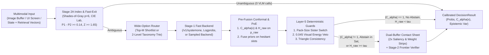

# Multimodal Decision Models (`multimodal-decision-models`)

Catalog-scale visual and relational classification ($K = 2$ to $10,000+$ classes) requires calibrated probabilities, finite-sample abstention sets, and zero-fallback wire contracts across heterogeneous model APIs. `multimodal-decision-models` (`v0.4.0`, zero external runtime dependencies) separates decision geometry and uncertainty quantification from the inference backend.

One declarative policy definition runs across four inference paradigms:

1. **Parallel Masked Diffusion (`/v1/systemone`)**: Co-denoises up to 8 slots $\times$ 26 options in one forward pass via `DgemSystemOneBackend`.
2. **Autoregressive Token Logprobs (`/v1/chat/completions`)**: Extracts restricted-vocabulary `top_logprobs` from `vLLM`, `SGLang`, `TGI`, `Gemma 4`, `Qwen-VL`, `Llama-Vision`, and OpenAI endpoints via `OpenAILogprobBackend`.
3. **Frontier Multimodal Verifiers (`VertexGeminiBackend`)**: Evaluates `gemini-3.8-flash` with single-token `[A-Z]` enum bijections and causal Evidence-First JSON schemas (`evidence_read` emitted ahead of slot choices).
4. **Logprob-Free Sampled Models (`BlackBoxSampledBackend`)**: Aggregates $M$ discrete draws or verbalized vote maps under a symmetric Dirichlet prior ($\alpha_0 = 0.5$) to preserve finite negative log-likelihood, non-zero Shannon entropy, and analytic epistemic variance.

## Funnel Architecture



## Module Overview

See [`docs/architecture.md`](docs/architecture.md) for mathematical derivations.

| Module | Mechanism |
| :--- | :--- |
| **[`conformal.py`](src/multimodal_decision_models/conformal.py)** | **Split Conformal and RAPS (`lac`, `aps`, `raps`):** Calibrates finite-sample quantile $\hat{q}$ at order index $\lceil(n+1)(1-\alpha)\rceil$ (`calibrate_conformal_quantile`) and builds prediction sets $\mathcal{C}_\alpha(x)$ (`conformal_prediction_set`) before prior fusion, flagging escalation when $|\mathcal{C}_\alpha(x)| \ne 1$ or an abstain option enters the set. |
| **[`calibration.py`](src/multimodal_decision_models/calibration.py)** | **Pre-Gated Bayesian PoE & Post-Hoc Scaling:** Measures $\tilde{H}_{\text{raw}}$ before fusing priors (`"hesitant"`, `"proportional"`, `"confident"`, `"always"`), fits $L_2$-regularized scalar temperature scaling (`fit_temperature_scaling`) and diagonal vector scaling shrunk toward $(1/T_0, 0)$ (`fit_vector_scaling`), and runs Stage-2A fast-exit plus Layer-5 deterministic guards. |
| **[`visual_compiler.py`](src/multimodal_decision_models/visual_compiler.py)** | **Dual-Buffer Visual Compiler:** Pure-stdlib PNG (filters `0..4`, RGB/RGBA/Gray, IEEE CRC32) and PPM (`P6`/`P3`) codecs; Stage-2A unsharpened Minkowski $p=6$ white balance, inner-80% CIE $L^*a^*b^*$ $\Delta E$ similarity, and residual MLP adapter `norm(q + alpha * W2 * GELU(W1 * q))`; Stage-2B contact sheets with automatic inter-candidate variance saliency bands, `2x` bottom-30% pack-weight zoom, and `1.15x` cylindrical unwarping. |
| **[`embedding_index.py`](src/multimodal_decision_models/embedding_index.py)** | **Multimodal Embedding Index:** `VertexMultimodalEmbeddingAdapter` wire builder/parser for `gemini-embedding-2` and JSONL-backed `MultimodalEmbeddingIndex` combining cosine or `CSLS` scores, CIE $L^*a^*b^*$ color similarity, Lidstone container aspect priors, and Stage-2A adaptive fast-exit. |
| **[`context_pruner.py`](src/multimodal_decision_models/context_pruner.py)** | **8-Slot Trajectory Context Pruner:** Packs agent context blocks into 8-slot single-pass policies (`build_context_pruning_questions`) and solves exact Pareto-frontier Multiple-Choice Knapsack optimization over `{"full", "stub", "drop"}` (`prune_agent_context_blocks`) under a token budget while retaining pinned blocks. |
| **[`mcp_server.py`](src/multimodal_decision_models/mcp_server.py)** | **MCP `stdio` Server (`dgem-catalog`):** Zero-dependency JSON-RPC 2.0 server (`python3 -m multimodal_decision_models.mcp_server`) supporting newline-delimited and `Content-Length` framing for `shortlist_candidates`, `evaluate_conformal_decision`, `prune_context_blocks`, and `compile_contact_sheet`. |
| **[`shortlist.py`](src/multimodal_decision_models/shortlist.py)** | **Wide-Option Shortlist Routing ($K > 26$):** Compresses wide taxonomies to a single pass over dense-embedding or `CSLS` top-$M$ candidates, converts raw cosines to temperature-scaled log-softmax priors ($\tau = 0.07$), and extracts opt-in sibling-unique cues (`pairwise_diff=True`). |
| **[`hierarchy.py`](src/multimodal_decision_models/hierarchy.py)** | **Taxonomy Tries (`TaxonomyTrie`, `HierarchicalDecisionRouter`):** Bounds coarse and fine slots to $\le 26$ `[A-Z]` options across $K \le 625$ classes with 1-pass `mtp_trie`, 2-pass `beam_2pass`, and `hesitation_hybrid` routing. |
| **[`contracts.py`](src/multimodal_decision_models/contracts.py)** | **Total Contracts & Caching:** Closed terminal state machine, simplex verification, `<untrusted_data>` prompt-injection fencing, and SHA-256 JSONL `ContentAddressedDecisionCache` persisting `conformal_set` and `epistemic_variance`. |
| **[`som_navigator.py`](src/multimodal_decision_models/som_navigator.py)** | **Set-of-Marks UI Navigation:** $3 \times 3$ and $4 \times 4$ grid helpers, unimodal-safe expected mark centers (`safe_expected_mark_center`), and nested smallest-area containment (`select_containing_or_nearest_mark`). |
| **[`consistency.py`](src/multimodal_decision_models/consistency.py)** | **Triangle Consistency & Unit Guards:** Continuous 3-cycle contradiction scoring (`score_probabilistic_triangles`), canonical metric/imperial pack-volume verification (`validate_pack_quantity_consistency`), and multi-slot swarm lock arbitration. |
| **[`backends.py`](src/multimodal_decision_models/backends.py)** | **Four-Paradigm Backends & Orchestrator:** `DgemSystemOneBackend`, `OpenAILogprobBackend`, `VertexGeminiBackend`, `BlackBoxSampledBackend`, and `CascadeDecisionOrchestrator` with pre-fusion conformal set gating and SLA quarantine. |
| **[`eval_suite.py`](src/multimodal_decision_models/eval_suite.py)** | **Scoring & Statistical Suite:** Multiclass Brier score, Murphy (`REL`, `RES`, `UNC`) decomposition, NLL, `ECE`, quantile-binned `ACE`, Macro-F1, `nDCG@k`, `AUROC`, selective `AURC`, exact paired McNemar test, Rogan-Gladen prevalence, Cohen's $\kappa$, and cluster bootstrap CIs. |
| **[`pkg/mdm/`](pkg/mdm/)** | **Go Reference Package (`package mdm`):** Zero-dependency Go 1.22 implementation covering `CalibrateConformalQuantile`, `ConformalPredictionSet`, `PruneAgentContextBlocks`, pre-gated prior fusion, shortlisting, taxonomy tries, Set-of-Marks geometry, triangle scoring, and pack-quantity guards. |

## Quickstart

```python
from multimodal_decision_models import (
    BlackBoxSampledBackend,
    CascadeDecisionOrchestrator,
    DecisionQuestion,
    DgemSystemOneBackend,
    calibrate_conformal_quantile,
)

questions = {
    "entity_relation": DecisionQuestion(
        type="choice",
        instructions="Compare Listing A and Listing B to determine catalog equivalence.",
        criteria={
            "exact_duplicate": "Identical brand, formulation, unit volume, and pack count",
            "sibling_variant": "Same brand/line, different flavor or multipack count",
            "distinct_product": "Unrelated product or brand",
        },
        order=["exact_duplicate", "sibling_variant", "distinct_product"],
    )
}

cal = calibrate_conformal_quantile(
    calib_probs=[{"exact_duplicate": 0.85, "sibling_variant": 0.10, "distinct_product": 0.05}] * 30,
    calib_labels=["exact_duplicate"] * 30,
    alpha=0.10,
    method="raps",
)

stage1 = DgemSystemOneBackend("http://127.0.0.1:8095")
stage2 = BlackBoxSampledBackend(
    "sampled-verifier",
    endpoint_url="http://127.0.0.1:8000",
    model="verifier-v1",
    num_samples=5,
    prior_alpha=0.5,
)

orchestrator = CascadeDecisionOrchestrator(
    stage1_backend=stage1,
    stage2_backend=stage2,
    hesitation_threshold=0.16,
    prior_weight=0.35,
    prior_gate_mode="hesitant",
    conformal_q_hat=cal.q_hat,
    conformal_method="raps",
)
```

## MCP Server and Tests

Launch the zero-dependency `dgem-catalog` MCP server over `stdio`:

```bash
PYTHONPATH=src python3 -m multimodal_decision_models.mcp_server
```

Run the Python and Go test suites:

```bash
PYTHONPATH=src python3 -m unittest discover -s tests -v
go test -race ./pkg/mdm/...
```

## Multi-Model Benchmark

Reproduce the 10-model calibration, post-hoc scaling, and Split Conformal RAPS cascade benchmark (`N = 50` multi-task calibration items and `N = 360` XSTest refusal-boundary items; see [`benchmarks/results/multimodel_benchmark_report.md`](benchmarks/results/multimodel_benchmark_report.md)):

```bash
PYTHONPATH=src python3 benchmarks/run_multimodel_benchmark.py
```

