# Multimodal Decision Models (`multimodal-decision-models`)

Backend-agnostic architecture, calibration primitives, and multi-slot policy templates for **Calibrated Multimodal Decision Models** at catalog scale ($K = 2 \to 10,000+$ classes).

`multimodal-decision-models` decouples **decision geometry and epistemic calibration** from the underlying inference engine. The same declarative policies, pre-gated prior fusion, wide-option shortlist routers, Set-of-Marks UI pathfinders, and transitive triangle-consistency verifiers execute across:

1. **Parallel Masked Diffusion Decision Models (`/v1/systemone`)**: Co-denoising up to 8 slots $\times$ 26 options in one forward pass via `DgemSystemOneBackend`.
2. **Autoregressive Single-Token Logprob Engines (`/v1/chat/completions`)**: `vLLM`, `SGLang`, `TGI`, `Gemma 4`, `Qwen-VL`, `Llama-Vision`, and OpenAI endpoints via restricted-vocabulary `top_logprobs` extraction (`OpenAILogprobBackend`).
3. **Frontier Multimodal Verifiers (`VertexGeminiBackend`)**: `gemini-3.8-flash` using Causal Attention **Evidence-First** JSON schemas (`evidence_read` emitted before slot choices so lower-triangular attention conditions directly on the decoded visual evidence in the KV cache).

---

## 1. End-to-End Decision Funnel Architecture

```mermaid
flowchart LR
    Q["Multimodal Input\n(Image Crops / UI Screen /\nTranscript + Prior Logits)"] --> S2A["Stage 2A Fast-Exit Gate\n(P1 - P2 >= 0.14, Z >= 1.65,\nNo Sister Pack Collision)"]
    S2A -- "Pass (0 VLM calls)" --> OUT["Calibrated DecisionResult\n(Probs, H_raw, Confidence C2)"]
    S2A -- "Ambiguous" --> SL["Wide-Option Shortlist\n(Dense / CSLS Top-M +\nCatch-All)"]
    SL --> EV["Evidence Slot Injection\n(Co-Denoised Canvas or\nCausal Evidence-First)"]
    EV --> B1["Stage-1 Fast Backend\n(/v1/systemone or\nLocal vLLM Logprobs)"]
    B1 --> POE["Pre-Gated Bayesian PoE\n1. Measure H_raw on p_raw\n2. Fuse exp(l_i/T + w*pi_i)"]
    POE --> L5["Layer-5 Deterministic Guards\n1. Pack-Size Sister Switch\n2. 0.045 Visual Energy Veto\n3. Triangle Consistency"]
    L5 -- "H_raw < 0.16 &\nConsistent" --> OUT
    L5 -- "H_raw >= 0.16 or\nTriangle/Pack Conflict" --> B2["Stage-2 Frontier Verifier\n(Gemini 3.8 Flash)"]
    B2 --> OUT
```



---

## 2. Core Modules & Mathematical Formulations

See [`docs/architecture.md`](docs/architecture.md) for full derivations and design guidance.

| Module | Core Mechanism |
| :--- | :--- |
| **[`calibration.py`](src/multimodal_decision_models/calibration.py)** | **Pre-Gated Bayesian PoE Fusion:** Evaluates cardinality-normalized Shannon entropy $\tilde{H}_{\text{raw}} = -\sum_{k=1}^K p_{\text{raw},k}\ln p_{\text{raw},k} / \ln K$ strictly *before* fusing retrieval or base-rate priors $p_k \propto \exp(\ln p_{\text{raw},k}/T + w_{\text{eff}}\cdot \pi_k)$, with configurable `gate_mode` (`"always"`, `"confident"`, `"hesitant"`, `"proportional"`).<br>**Stage 2A Fast-Exit Gate:** Resolves high-margin dense-embedding hits ($P_1 - P_2 \ge 0.14, Z \ge 1.65$) in `0` VLM calls.<br>**Layer-5 Post-Generation Guards:** Deterministic Pack-Size Sister Switch, `0.045` Visual Energy Veto, and `none_of_the_above` Competitor Similarity Guard ($\ge 0.72$). |
| **[`shortlist.py`](src/multimodal_decision_models/shortlist.py)** | **Catalog-Scale Shortlist Routing ($K \to 10,000+$):** Reduces wide choices ($K > 26$) from multi-pass bracket tournaments ($\lceil K/20 \rceil + 1$ passes) to a single pass over dense-embedding or Cross-Domain Similarity Local Scaling (`CSLS(q, p_k) = 2\cos(q, p_k) - r_T(p_k)`) top-$M$ candidates plus `none_of_the_above` catch-all preservation and optional pairwise contrastive descriptions. |
| **[`som_navigator.py`](src/multimodal_decision_models/som_navigator.py)** | **Set-of-Marks (`SoM`) Discrete UI Pathfinder:** Replaces continuous coordinate regression with $3 \times 3$ `grid_cell` spatial filtering (`filter_marks_by_grid_cell`), nested smallest-area containment and nearest-mark snapping (`select_containing_or_nearest_mark`), and 4-slot single-pass policy construction (`next_target_mark`, `element_state`, `loop_or_error_detected`, `goal_progress_score`). |
| **[`consistency.py`](src/multimodal_decision_models/consistency.py)** | **Transitive Triangle-Consistency Checker (`check_transitive_triangles`):** Detects 3-cycles $(A, B, C)$ where two edges satisfy $P(\text{equiv}) \ge \tau_{\text{high}}$ (`0.80`) and the third satisfies $P(\text{equiv}) \le \tau_{\text{low}}$ (`0.25`).<br>**Pack-Quantity Equivalence Verifier:** Parses multipack multipliers (`6x330ml` $\to 6$, `Pack of 12` $\to 12$) and blocks false `exact_duplicate` merges.<br>**Multi-Slot Swarm Lock Arbiter (`arbitrate_swarm_locks`):** Resolves concurrent worker file-write collisions in a single pass. |
| **[`backends.py`](src/multimodal_decision_models/backends.py)** | Unified `DecisionBackend` protocol implemented by `DgemSystemOneBackend` (`/v1/systemone`), `OpenAILogprobBackend` (`/v1/chat/completions`), `VertexGeminiBackend` (Vertex AI `generateContent`), and `CascadeDecisionOrchestrator`. |
| **[`pkg/mdm/`](pkg/mdm/)** | Standalone Go reference implementation (`package mdm`) for pre-gated prior fusion, dense-prior wide-option shortlisting, Set-of-Marks geometry, and transitive triangle-consistency checking. |

---

## 3. Quickstart Across Backends

```python
from multimodal_decision_models import (
    CascadeDecisionOrchestrator,
    DecisionQuestion,
    DgemSystemOneBackend,
    OpenAILogprobBackend,
    VertexGeminiBackend,
)

# 1. Define a backend-agnostic question (runs on /v1/systemone, vLLM/OpenAI, or Vertex Gemini)
questions = {
    "entity_relation": DecisionQuestion(
        type="choice",
        instructions="Compare Listing A and Listing B to determine catalog equivalence.",
        criteria={
            "exact_duplicate": "Identical brand, formulation, unit volume, and pack count",
            "sibling_variant": "Same brand/line, different flavor or multipack count",
            "distinct_product": "Unrelated product or brand",
        },
        order=["exact_duplicate", "sibling_variant", "distinct_product"],
    )
}

# 2. Plug in ANY Stage-1 fast backend (/v1/systemone OR vLLM /v1/chat/completions)
stage1 = DgemSystemOneBackend("http://localhost:8095")
# Or: stage1 = OpenAILogprobBackend("http://localhost:8000", model="google/gemma-4-9b-it")

# 3. Plug in a Stage-2 frontier escalation backend (Vertex AI Gemini 3.8 Flash)
stage2 = VertexGeminiBackend(project="my-gcp-project", model="gemini-3.8-flash")

orchestrator = CascadeDecisionOrchestrator(
    stage1_backend=stage1,
    stage2_backend=stage2,
    hesitation_threshold=0.16,
    prior_weight=0.35,
    prior_gate_mode="hesitant",
    shortlist_top_k=15,
    evidence_prompt="Identify the decisive visual or pack-quantity cue before choosing.",
    enable_stage2a_fast_exit=True,
)
```

---

## 4. Running Tests

```bash
PYTHONPATH=src pytest -v
go test ./pkg/mdm/...
```
