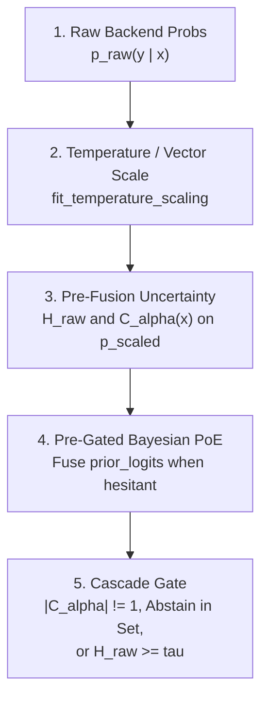

# Calibration, conformal sets, and risk control

`multimodal-decision-models` converts raw model logits into calibrated decisions through temperature scaling, pre-gated Bayesian Product-of-Experts (`PoE`) fusion, conformal prediction sets, and Learn-then-Test (`LTT`) risk bounds.

## Why raw probabilities fail in production

Raw softmax outputs from autoregressive and masked-diffusion models exhibit three recurring failure modes:

1. **Miscalibrated sharpness**: Models over-concentrate probability mass on familiar phrasings while flattening mass on rare classes.
2. **Prior masking**: Applying a strong retrieval or popularity prior *before* measuring model uncertainty hides input ambiguity and blocks Stage-2 escalation on occluded or out-of-scope items.
3. **Multi-slot error compounding**: Five independent slots each calibrated at `90%` marginal coverage ($\alpha = 0.10$) yield only `60.42%` simultaneous workflow coverage on `LocalLLaMA/typed-decisions` ($0.9^5 \approx 0.59$).

## Order of operations in the calibration pipeline

`CascadeDecisionOrchestrator` executes uncertainty quantification in a strict sequence so retrieval priors do not mask model hesitation:



## Fit post-hoc temperature and vector scaling

Use `fit_temperature_scaling` ($L_2$-regularized 81-point log-space grid search + damped Newton-Raphson) or `fit_vector_scaling` (class-wise diagonal temperatures shrunk toward scalar $T_0$) on a held-out validation split:

```python
from multimodal_decision_models import (
    brier_murphy_decomposition,
    fit_temperature_scaling,
)

scaler = fit_temperature_scaling(
    validation_probabilities,
    validation_gold_labels,
    l2_reg=1e-3,
)
calibrated_probs = scaler.predict_proba(test_probabilities)
murphy = brier_murphy_decomposition(calibrated_probs, test_gold_labels)
```

On the 10-model calibration benchmark (`benchmarks/results/multimodel_benchmark_report.md`), out-of-fold temperature scaling paired with pre-gated `PoE` improves `TypedDecisions` accuracy to `83.50%` and reduces multiclass Brier score from `0.4090` to `0.2449`.

## Preserve hesitation with Pre-Gated Bayesian PoE

`pre_gated_bayesian_poe_fusion` computes normalized Shannon entropy $\tilde{H}_{\text{raw}} \in [0, 1]$ (and catalog-size-invariant `effective_top_m_entropy` for wide slots) *before* combining `prior_logits`:

- `gate_mode="hesitant"` (default): Leaves sharp Stage-1 predictions untouched when $\tilde{H}_{\text{raw}} < \tau$, and fuses retrieval or acoustic priors $\log p(y) + w \cdot \ell_{\text{prior}}(y)$ only when Stage 1 hesitates ($\tilde{H}_{\text{raw}} \ge \tau$).
- `gate_mode="confident"`: Fuses priors only on low-entropy predictions.
- `gate_mode="proportional"`: Scales effective prior weight continuously by $w \cdot \tilde{H}_{\text{raw}}$.

## Build stateless `HMAC-SHA256` conformal prediction sets

`calibrate_conformal_quantile` computes the exact finite-sample order-statistic quantile $\hat{q}$ at index $\lceil (n + 1)(1 - \alpha) \rceil$ across three nonconformity scores:

| Method | Nonconformity score $s(x, y)$ | Best suited for |
| :--- | :--- | :--- |
| `"lac"` | $1 - \hat{\pi}_y(x)$ | Small binary or 3-way routing slots (`K <= 4`) minimizing average set size. |
| `"aps"` | $\sum_{y': \hat{\pi}_{y'} > \hat{\pi}_y} \hat{\pi}_{y'}(x) + u \cdot \hat{\pi}_y(x)$ | Adaptive conditional coverage across variable-difficulty inputs. |
| `"raps"` | $\text{APS}(x, y) + \lambda_{\text{reg}} \max(0, \text{rank}(y) - k_{\text{reg}})$ | Wide slots (`K = 6..255`) where tail rank regularization shrinks diffuse sets. |

### Thread-safe cross-language tie-breaking

Stateful PRNG streams change prediction sets when worker threads reorder requests. Pass `seed_key` and `item_key` to switch `aps` and `raps` to stateless `HMAC-SHA256` randomization (`hmac_uint64` and `hmac_uniform_float64`). All three SDKs (Python / Go / TypeScript) then produce identical sets regardless of batch order:

```python
from multimodal_decision_models import (
    STANDARD_CONFORMAL_ABSTAIN_KEYS,
    conformal_prediction_set,
)

result = conformal_prediction_set(
    probs={"approve": 0.46, "manual_review": 0.46, "abstain": 0.08},
    q_hat=0.52,
    method="raps",
    randomized=True,
    seed_key="dgem-conformal-v1",
    item_key="order-8841:disposition",
    abstain_keys=STANDARD_CONFORMAL_ABSTAIN_KEYS,
)
# Escalate whenever |C_alpha(x)| != 1 or an opted-in abstain option enters C_alpha(x)
should_escalate = result.should_escalate
```

To prevent false singleton escalations on datasets where labels such as `"oos"` (`CLINC150`) or `"0"` are valid target classes, conformal abstain escalation is empty by default (`DEFAULT_CONFORMAL_ABSTAIN_KEYS = frozenset()`, Go `DefaultConformalConfig().AbstainKeys == nil`, and TypeScript `DEFAULT_ABSTAIN_LABELS = []`). Pass `STANDARD_CONFORMAL_ABSTAIN_KEYS` (Go `StandardConformalAbstainKeys()`, TypeScript `STANDARD_ABSTAIN_LABELS`) or custom catch-all keys when your schema includes open-world abstention options.

Logprob extractors (`OpenAILogprobBackend`, `VertexGeminiBackend`, and TypeScript `decideChatLogprobs`) aggregate whitespace-equivalent SentencePiece and BPE subword tokens (`"A"` and `" A"`) by using log-space `logaddexp` instead of taking a single-token maximum so calibration receives the full option probability mass.

## Bound multi-slot workflows with Joint Conformal

When an agent or workflow acts on $S$ coupled slots simultaneously (such as `action`, `needs_review`, `outcome`, `risk`, and `urgency`), calibrate the max-score quantile $M_i = \max_{s \in \{1..S\}} s(X_{i,s}, Y_{i,s})$ by using `calibrate_multislot_joint_conformal`:

```python
from multimodal_decision_models import (
    calibrate_multislot_joint_conformal,
    multislot_joint_conformal_sets,
)

joint_cal = calibrate_multislot_joint_conformal(
    calib_slot_probs=heldout_slot_probs,
    calib_slot_labels=heldout_slot_labels,
    alpha=0.10,
    method="raps",
)
slot_sets = multislot_joint_conformal_sets(live_slot_probs, joint_cal)
```

On the 5-slot `TypedDecisions` benchmark, `calibrate_multislot_joint_conformal` raises simultaneous 5-slot coverage from `60.42%` (independent per-slot RAPS) to `97.92%` (`96.50%` on the full $N = 2,000$ evaluation).

## Handle rare classes, distribution shift, and funnel gates

- **Rare-class protection (`Mondrian` conformal)**: `calibrate_mondrian_conformal_quantiles` fits per-class or per-group thresholds, raising rare-tail coverage on `MDM-Bench` from `58.75%` to `88.75%`.
- **Null-prior debiasing and unlabeled `SLD` label-shift adaptation (`v1.2.0`)**: `debias_null_prior_probabilities` divides out empty-context option bias $p_k^{\text{debiased}} \propto p_k / (p_k^{\text{null}})^\gamma$. For prevalence shift without target labels, `adapt_sld_label_shift_posteriors` and `label_shift_weighted_conformal_prediction_set` reweight posteriors and conformal scores through Saerens-Latinne-Decaestecker (`SLD`) EM.
- **Held-out competence circuit breaker and Dawid-Skene `PoE` weights (`v1.3.1`)**: `DomainCompetenceProfile.is_negative_transfer` blocks Stage-2 overrides because negative paired escalation, accuracy drops beyond `margin`, or multiclass Brier error spikes (`stage2_brier` vs `stage1_brier`) degrade end-to-end risk. `compute_dawid_skene_poe_weights` derives Stage-1 and Stage-2 fusion weights from multi-class log-odds above `1/K` chance, matching across all three SDKs (Python / Go / TypeScript) within `1e-12`.
- **Finite-sample Conformal Risk Control (`CRC`), Bayesian `VoI`, and epistemic abstention (`v1.2.0`)**: `calibrate_conformal_risk_control` selects $\hat{\lambda} = \inf\{\lambda : \frac{n}{n+1}\hat{R}_n(\lambda) + \frac{B}{n+1} \le \alpha\}$ so $\mathbb{E}[L_{n+1}(\hat{\lambda})] \le \alpha$. `compute_bayes_value_of_information` escalates only when expected risk reduction exceeds Stage-2 cost ($\text{VoI}(x) > c_{\text{S2}}$), and `select_omniscience_action` abstains below $p^* = C / (R + C)$.
- **Non-stationary streams (`BC-ACI`)**: `OnlineBCACITracker` updates $\alpha_t$ online with bias-corrected momentum. On the modeled abrupt-shift stream benchmark, it restores `90.00%` post-shift coverage where static RAPS drops to `30.00%`.
- **Learn-then-Test (`LTT`) funnel gates**: `calibrate_ltt_funnel_gates` uses finite-sample Hoeffding-Bentkus upper confidence bounds with family-wise testing to select `(stage2a_margin, hesitation_threshold)` tuples guaranteed to hold end-to-end funnel risk below your target $\alpha$.
