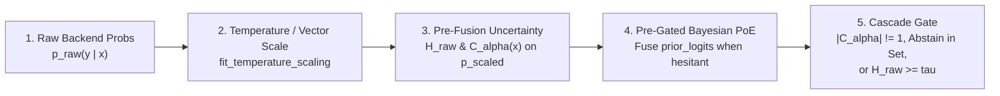

# Calibration, conformal sets, and risk control

To convert raw model logits into trustworthy automation thresholds, `multimodal-decision-models` layers post-hoc probability calibration, pre-gated Bayesian Product-of-Experts (`PoE`) fusion, distribution-free conformal prediction sets, and finite-sample Learn-then-Test (`LTT`) funnel risk bounds.

## Why raw probabilities fail in production

Raw softmax outputs from autoregressive and masked-diffusion models exhibit three recurring failure modes:

1. **Miscalibrated sharpness**: Models over-concentrate probability mass on familiar phrasings while flattening mass on rare classes.
2. **Prior masking**: Adding a strong retrieval or popularity prior *before* measuring model uncertainty hides visual or textual ambiguity, preventing Stage-2 escalation when the input is occluded or out-of-scope.
3. **Multi-slot error compounding**: Five independent slots each calibrated at `90%` marginal coverage ($\alpha = 0.10$) yield only `60.42%` simultaneous workflow coverage on `LocalLLaMA/typed-decisions` ($0.9^5 \approx 0.59$).

## Order of operations in the calibration pipeline

`CascadeDecisionOrchestrator` executes uncertainty quantification in a strict sequence so retrieval priors never mask model hesitation:



## Fit post-hoc temperature and vector scaling

Use `fit_temperature_scaling` ($L_2$-regularized 81-point log-space grid search + damped Newton-Raphson) or `fit_vector_scaling` (class-wise diagonal temperatures shrunk toward scalar $T_0$) on a held-out validation split:

```python
from multimodal_decision_models import (
    brier_murphy_decomposition,
    fit_temperature_scaling,
)

scaler = fit_temperature_scaling(
    validation_probabilities,
    validation_gold_labels,
    l2_reg=1e-3,
)
calibrated_probs = scaler.predict_proba(test_probabilities)
murphy = brier_murphy_decomposition(calibrated_probs, test_gold_labels)
```

On the 10-model calibration benchmark (`benchmarks/results/multimodel_benchmark_report.md`), out-of-fold temperature scaling paired with pre-gated `PoE` improves `TypedDecisions` accuracy to `83.50%` and reduces multiclass Brier score from `0.4090` to `0.2449`.

## Preserve hesitation with Pre-Gated Bayesian PoE

`pre_gated_bayesian_poe_fusion` computes normalized Shannon entropy $\tilde{H}_{\text{raw}} \in [0, 1]$ (and catalog-size-invariant `effective_top_m_entropy` for wide slots) *before* combining `prior_logits`:

- `gate_mode="hesitant"` (default): Leaves sharp Stage-1 predictions untouched when $\tilde{H}_{\text{raw}} < \tau$, and fuses retrieval or acoustic priors $\log p(y) + w \cdot \ell_{\text{prior}}(y)$ only when Stage 1 hesitates ($\tilde{H}_{\text{raw}} \ge \tau$).
- `gate_mode="confident"`: Fuses priors only on low-entropy predictions.
- `gate_mode="proportional"`: Scales effective prior weight continuously by $w \cdot \tilde{H}_{\text{raw}}$.

## Build stateless `HMAC-SHA256` conformal prediction sets

`calibrate_conformal_quantile` computes the exact finite-sample empirical quantile $\hat{q}$ at order index $\lceil (n + 1)(1 - \alpha) \rceil$ across three nonconformity scores:

| Method | Nonconformity score $s(x, y)$ | Best suited for |
| :--- | :--- | :--- |
| `"lac"` | $1 - \hat{\pi}_y(x)$ | Small binary or 3-way routing slots (`K <= 4`) minimizing average set size. |
| `"aps"` | $\sum_{y': \hat{\pi}_{y'} > \hat{\pi}_y} \hat{\pi}_{y'}(x) + u \cdot \hat{\pi}_y(x)$ | Adaptive conditional coverage across variable-difficulty inputs. |
| `"raps"` | $\text{APS}(x, y) + \lambda_{\text{reg}} \max(0, \text{rank}(y) - k_{\text{reg}})$ | Wide slots (`K = 6..255`) where tail rank regularization shrinks diffuse sets. |

### Thread-safe cross-language tie-breaking

Stateful PRNG streams produce different prediction sets when requests arrive in different orders across worker threads. Passing `seed_key` and `item_key` switches `aps` and `raps` to stateless `HMAC-SHA256` randomization (`hmac_uint64` and `hmac_uniform_float64`), guaranteeing identical sets regardless of batch permutation across Python, Go, and TypeScript:

```python
from multimodal_decision_models import conformal_prediction_set

result = conformal_prediction_set(
    probs={"approve": 0.46, "manual_review": 0.46, "abstain": 0.08},
    q_hat=0.52,
    method="raps",
    randomized=True,
    seed_key="dgem-conformal-v1",
    item_key="order-8841:disposition",
)
# Escalate whenever |C_alpha(x)| != 1 or an abstain option enters C_alpha(x)
should_escalate = result.should_escalate
```

## Bound multi-slot workflows with Joint Conformal

When an agent or workflow acts on $S$ coupled slots simultaneously (such as `action`, `needs_review`, `outcome`, `risk`, and `urgency`), calibrate the max-score quantile $M_i = \max_{s \in \{1..S\}} s(X_{i,s}, Y_{i,s})$ via `calibrate_multislot_joint_conformal`:

```python
from multimodal_decision_models import (
    calibrate_multislot_joint_conformal,
    multislot_joint_conformal_sets,
)

joint_cal = calibrate_multislot_joint_conformal(
    calib_slot_probs=heldout_slot_probs,
    calib_slot_labels=heldout_slot_labels,
    alpha=0.10,
    method="raps",
)
slot_sets = multislot_joint_conformal_sets(live_slot_probs, joint_cal)
```

On the 5-slot `TypedDecisions` benchmark, `calibrate_multislot_joint_conformal` raises simultaneous 5-slot coverage from `60.42%` (independent per-slot RAPS) to `97.92%` (`96.50%` on the full $N = 2,000$ evaluation).

## Handle rare classes, distribution shift, and funnel gates

- **Rare-class protection (`Mondrian` conformal)**: `calibrate_mondrian_conformal_quantiles` fits per-class or per-group thresholds, raising rare-tail coverage on `MDM-Bench` from `58.75%` to `88.75%`.
- **Covariate and label shift**: `label_shift_weighted_conformal_prediction_set` and `estimate_saerens_em_prior_logits` reweight calibration scores under target prevalence shifts without labeled target data.
- **Adversarial / non-stationary streams (`BC-ACI`)**: `OnlineBCACITracker` adapts $\alpha_t$ online via bias-corrected momentum, recovering `90.00%` post-shift coverage after abrupt distribution shifts where static RAPS drops to `30.00%`.
- **Learn-then-Test (`LTT`) funnel gates**: `calibrate_ltt_funnel_gates` uses finite-sample Hoeffding-Bentkus upper confidence bounds with family-wise testing to select `(stage2a_margin, hesitation_threshold)` tuples guaranteed to hold end-to-end funnel risk below your target $\alpha$.
